# Ethereum Token Malice Prediction via Spatio-Temporal Graph Neural Networks

## Overview

This repository contains a pipeline for Ethereum ERC-20 token malice classification using Spatio-Temporal Graph Neural Networks (ST-GNNs).

The project models token transaction histories as discrete temporal dynamic graphs (sequences of time-windowed transaction graphs) to classify whether a token is malicious (rug pull) or benign based on its first 90 days of on-chain transfer activity.

> **Project Status — Concluded / Post-Mortem**:
> The project concluded without achieving classification capability on the positive class. The primary bottleneck was batch processing variable-sized, discrete time-evolving graphs within PyTorch Geometric and PyTorch Geometric Temporal. The codebase, methodology, and experimental failure modes are documented below.

---

## Problem Formulation

Token transfers are represented as a sequence of directed multigraphs over time:
- **Nodes**: Ethereum wallet addresses.
- **Edges**: ERC-20 token transfer events with transfer amounts and timestamps.
- **Temporal Discretization**: First 90 days of token transactions partitioned into $T = 6$ sequential snapshots.
- **Target Label**: Binary classification $y \in \{0, 1\}$ (0 = Benign, 1 = Malicious).

```mermaid
flowchart LR
    subgraph Data["1. Data Sourcing"]
        BQ[("Google BigQuery: crypto_ethereum")]
        RP[("Rug Pull Dataset: Dianxiang Sun et al.")]
    end

    subgraph Pre["2. Preprocessing & Graph Construction"]
        CSV["Token Transfer CSVs (90-day window)"]
        Snap["Snapshot Partitioning (T=6)"]
        Feat["Node & Edge Feature Extraction"]
    end

    subgraph Model["3. Spatio-Temporal Model"]
        TF["TransformerConv (Spatial Encoder)"]
        EV["EvolveGCN-O (Temporal Recurrence)"]
        Pool["Global Mean + Max Pooling"]
        Cls["MLP Classifier"]
    end

    Data --> Pre --> Model --> Pred["Prediction (0 or 1)"]
```



---

## Pipeline and Architecture

### 1. Data Ingestion (`scraper/`)
- **Malicious Tokens**: Sourced from the Dianxiang Sun rug pull dataset.
- **Benign Tokens**: Extracted from Google BigQuery (`bigquery-public-data.crypto_ethereum.tokens` and `token_transfers`), excluding addresses present in the malicious dataset.
- **Windowing**: Restricts transactions to the first 90 days following token inception.

### 2. Temporal Graph Construction (`token_malice_predictor/dataset.py`)
Each token is mapped to a `TemporalGraphData` sequence of $T$ snapshots $[G^{(1)}, G^{(2)}, \dots, G^{(T)}]$:
- **Node Features (8 dimensions)**:
  - Windowed (4 dimensions): $[\text{out\_degree}, \text{out\_volume}, \text{in\_degree}, \text{in\_volume}]$ for the snapshot window.
  - Cumulative (4 dimensions): Running prefix sums of the same four metrics across snapshots.
  - Values are aggregated using unbounded integer arithmetic and normalized via $\log(1 + x)$.
- **Edge Features (5 dimensions)**:
  - $[\log(1 + \text{amount}), \Delta t_{\text{window}}, \Delta t_{\text{global}}, \sin(2\pi \cdot t_{\text{global}}), \cos(2\pi \cdot t_{\text{global}})]$.
- **Edge Simplification**: Precomputed bidirectional coalesced edge indices for recurrent operators.

### 3. Model Architecture (`token_malice_predictor/classifier.py`)
- **Spatial Encoder**: `TransformerConv` with multi-head attention processing node and edge features per snapshot.
- **Normalization and Regularization**: LayerNorm and Dropout following spatial encoding.
- **Temporal Operator**: `EvolveGCNO` updating graph convolutional weights across snapshots via recurrent mechanisms.
- **Graph Pooling**: Concatenation of global mean pooling and global max pooling.
- **Classification Head**: Two-layer MLP with LayerNorm, ReLU, Dropout, and a single logit output trained with `BCEWithLogitsLoss`.

---

## Technical Post-Mortem

### 1. Dynamic Graph Batching Limitation
- In static Graph Neural Networks, mini-batching variable-sized graphs uses block-diagonal adjacency matrix concatenation (`Batch.from_data_list`).
- For discrete temporal dynamic graphs, each sample is an independent sequence of snapshots $G_i^{(1)}, \dots, G_i^{(T)}$ where node sets $V_i^{(t)}$ and edge sets $E_i^{(t)}$ vary across both time $t$ and sample index $i$.
- `torch-geometric-temporal` lacks native multi-graph dynamic batching primitives. Collation was implemented as an identity function (`temporal_collate_fn = lambda b: b`), forcing sample-by-sample execution in Python loops.

### 2. Recurrent Weight State Management
- `EvolveGCN-O` maintains recurrent parameter states across timesteps.
- When processing independent graphs sequentially within a training iteration, internal state variables had to be reset (`self.evolver.weight = None`) per sample to prevent computational graph reuse errors during backward passes.
- This serial execution prevented parallel GPU utilization.

### 3. Class Imbalance and Optimization Collapse
- The dataset exhibits class imbalance (approximately 96% benign, 4% malicious).
- The model converged to predicting the majority class (0) for all test samples.
- The resulting metrics showed 95.98% accuracy with 0.00 precision, 0.00 recall, and 0.00 F1 score across all configurations.

---

## Repository Structure

```
blg561e_project/
├── config.yaml                         # Configuration file for data, training, and ablation runs
├── requirements.txt                    # Project dependencies
├── Token_Malice_Prediction_Colab.ipynb # Metric computation and visualization notebook
├── outputs/                            # Checkpoints and output metrics
│   ├── results.jsonl                   # Output metrics per experiment run
│   ├── hidden_32/                      # Checkpoints for hidden_dim=32
│   ├── hidden_64/                      # Checkpoints for hidden_dim=64
│   └── hidden_128/                     # Checkpoints for hidden_dim=128
├── scraper/                            # Data scraping package
│   ├── __init__.py
│   └── __main__.py                     # Scrapes malicious dataset and BigQuery transfers
└── token_malice_predictor/             # Model and training package
    ├── __init__.py
    ├── __main__.py                     # CLI entrypoint for training and ablations
    ├── classifier.py                   # TokenMaliceClassifier model definition
    ├── dataset.py                      # TemporalGraphDataset and snapshot collation logic
    ├── preprocessor.py                 # CSV loading, validation, and address mapping
    ├── trainer.py                      # Training loop, evaluation, and checkpoint management
    └── metrics.py                      # Metric computation routines
```

---

## Installation and Execution

### 1. Installation

```bash
python -m venv venv
source venv/bin/activate  # On Windows: .\venv\Scripts\activate
pip install --no-cache-dir -r requirements.txt --find-links https://data.pyg.org/whl/torch-2.8.0+cpu.html
```

### 2. Data Collection

```bash
# Fetch token list
python -m scraper --fetch

# Query and download transactions from BigQuery
python -m scraper --process
```

*Note: Requires Google Cloud credentials configured via `GOOGLE_APPLICATION_CREDENTIALS`.*

### 3. Model Training

```bash
python -m token_malice_predictor config.yaml
```

The pipeline:
1. Loads raw CSV data.
2. Computes node and edge features across time windows using multiprocessing.
3. Saves preprocessed graph representations to `data/graph_cache.pt`.
4. Executes stratified training and evaluation for each run in `config.yaml`.
5. Logs output metrics to `outputs/results.jsonl`.

### 4. Evaluation Notebook

Launch Jupyter and open `Token_Malice_Prediction_Colab.ipynb` to inspect loss curves, confusion matrices, and ROC/PR curves.

---


## References

- Dianxiang Sun et al., *Tracking and Detecting Rug Pulls in Decentralized Finance*, [Dataset Repository](https://github.com/dianxiang-sun/rug_pull_dataset).
- Google Cloud BigQuery, *Ethereum Public Dataset (`crypto_ethereum`)*.
- Rozemberczki et al., *PyTorch Geometric Temporal: Spatiotemporal Signal Processing with Neural Machine Learning Systems*, CIKM 2021.
- Aldo Pareja et al., *EvolveGCN: Evolving Graph Convolutional Networks for Dynamic Graphs*, AAAI 2020.